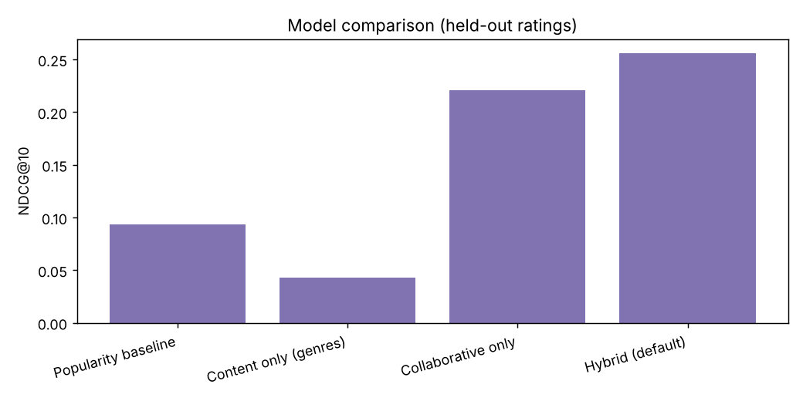

# 🎬 Movie Recommendation System

A hybrid movie recommender trained on real **MovieLens** ratings. It combines item-based collaborative filtering, genre similarity and a popularity prior, and is served through a secure Flask web app, a CLI and a Streamlit app.

**Tech stack:** Python · NumPy · pandas · Flask · SQLite · Streamlit · Docker · Vercel · GitHub Actions

---

## Results

Evaluated on held-out ratings (`ml-1m`, 600 test users, top-10 recommendations). 20% of every user's ratings were hidden, models were trained on the rest, and a recommendation counts as a hit if it matches a hidden movie the user rated 4 or higher.

| Model | Precision@10 | Recall@10 | Hit-rate@10 | NDCG@10 |
|---|---|---|---|---|
| Popularity baseline | 0.079 | 0.043 | 0.442 | 0.093 |
| Content only (genres) | 0.037 | 0.027 | 0.250 | 0.043 |
| Collaborative filtering only | 0.183 | 0.106 | 0.688 | 0.221 |
| **Hybrid (final model)** | **0.209** | **0.135** | **0.760** | **0.256** |

The hybrid ranks about 2.7× better than the popularity baseline (NDCG). Reproduce with `python -m scripts.evaluate --dataset ml-1m`.



## Features

- **Search** with live suggestions and typo-tolerant title matching
- **Similar movies** with a similarity score (0–100%) and a short explanation
- **Top rated** list using a weighted rating, so movies with few votes do not dominate
- **Genre, minimum-ratings and result-count filters**
- **Personal taste profile**: rate movies and get tailored recommendations (stored only in the browser)
- **Dark mode**, responsive layout, print stylesheet, accessible markup (skip link, ARIA tabs)
- **Command-line tool** and an alternative **Streamlit** interface

## How It Works

1. **Item-based collaborative filtering**: each user's ratings are mean-centred, cosine similarity is computed between movies, and pairs backed by few common raters are shrunk toward zero.
2. **Content model**: TF-IDF (implemented from scratch in NumPy) over genres and release decade, which helps movies with few ratings.
3. **Popularity prior**: Bayesian weighted rating.
4. **Hybrid score**: `0.70 × CF + 0.25 × content + 0.05 × popularity` (each min-max scaled). Weights were tuned on one random split and reported on a different one.

## Project Structure

```
├── server.py              # Web entry point (gunicorn server:app)
├── web/                   # Flask app: routes, security helpers, SQLite store, templates, static files
├── src/
│   ├── data.py            # Load, clean and split MovieLens data
│   ├── models.py          # ItemCF, ContentModel, PopularityModel
│   ├── recommender.py     # Hybrid recommender (public API)
│   └── evaluation.py      # Hold-out evaluation (precision, recall, hit-rate, NDCG, coverage)
├── scripts/               # prepare_data, evaluate, make_charts, check_secrets, make_admin_hash
├── data/processed/        # Ready-to-use datasets: ml-small, ml-1m, ml-25m-top
├── tests/                 # 60+ tests: recommender, web, security, deployment
├── api/index.py · vercel.json   # Vercel serverless entry point
├── notebooks/eda.ipynb    # Exploratory analysis
├── cli.py · streamlit_app.py
└── Dockerfile · .github/workflows/ci.yml · requirements.txt
```

## Getting Started

```bash
git clone https://github.com/manishyadav-aiml/movie-recommender.git
cd movie-recommender
python -m venv venv
venv\Scripts\activate              # Windows  (Mac/Linux: source venv/bin/activate)
pip install -r requirements.txt
copy .env.example .env             # Mac/Linux: cp .env.example .env
python server.py                   # open http://127.0.0.1:5000
```

Other interfaces and commands:

```bash
python cli.py "The Matrix" -n 5
python cli.py --rate "The Godfather=5" "Heat=4.5" --genre Crime
pip install -r requirements-streamlit.txt && streamlit run streamlit_app.py
pip install -r requirements-dev.txt && pytest
docker build -t movie-recommender . && docker run -p 8000:8000 --env-file .env movie-recommender
```

## Deploy on Vercel

1. Push the repository to GitHub and import it at [vercel.com/new](https://vercel.com/new) (framework preset: *Other*).
2. Add environment variables: `APP_ENV=production` and `SECRET_KEY` (generate with `python -c "import secrets; print(secrets.token_hex(32))"`).
3. Deploy. The bundle ships only the `ml-small` dataset (`.vercelignore`), so cold starts take about a second. The feedback form and admin inbox are switched off on Vercel because serverless functions have a read-only disk.

## Dataset

[MovieLens](https://grouplens.org/datasets/movielens/) by GroupLens Research (University of Minnesota). Three processed versions are included: `ml-small` (100K ratings), `ml-1m` (1M ratings) and `ml-25m-top` (2M ratings, 5,000 most-rated movies). Switch with `MOVIES_DATASET=ml-25m-top`, or rebuild from raw files with `python -m scripts.prepare_data`.

## Security

Input validation on every endpoint, CSRF tokens and Origin checks on all POST requests, rate limiting, parameterised SQL, output escaping with a strict Content-Security-Policy, security headers, no secrets in code (environment variables only), hashed-password admin area, generic error messages, and a secret-scanning script run in CI. The behaviour is covered by 33 automated security tests.

## Limitations and Future Work

- MovieLens has no plot, cast or poster data, so the content model uses genres only.
- Planned: matrix factorization (SVD/ALS) for comparison, movie posters via the TMDB API, and a live deployment.

## Author

**Manish Kumar Yadav**

- GitHub: [github.com/manishyadav-aiml](https://github.com/manishyadav-aiml)
- LinkedIn: [linkedin.com/in/manishkumaryadav946](https://www.linkedin.com/in/manishkumaryadav946)

Code released under the MIT License. MovieLens data © GroupLens Research.
